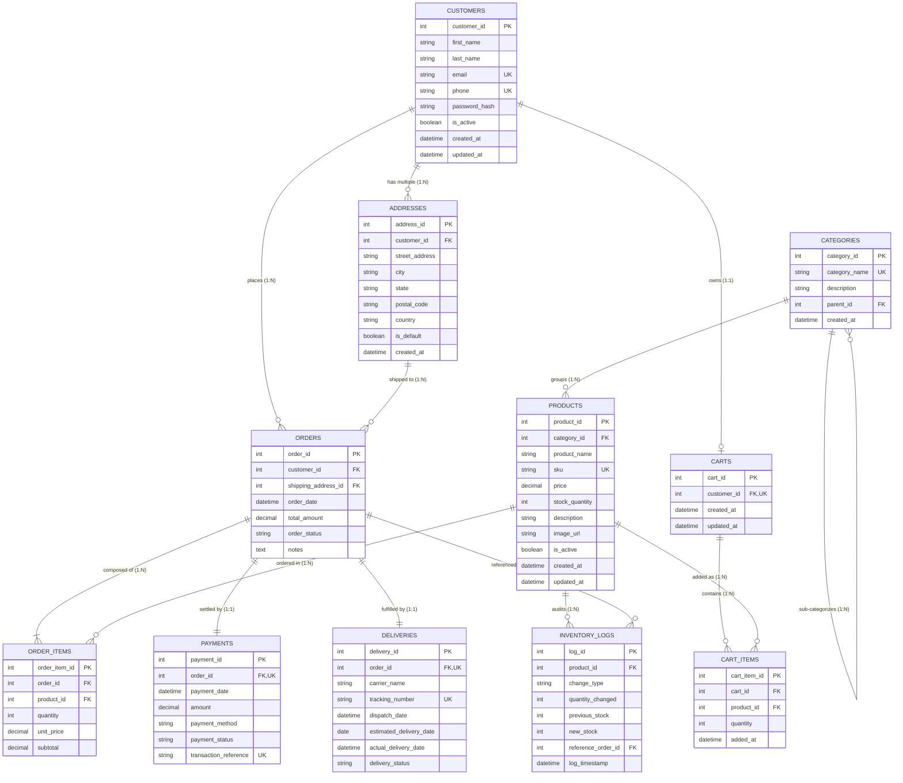

# Entity-Relationship (ER) Diagram

**Institution:** Manipal University Jaipur  
**Course:** Relational Database Management Systems Laboratory  
**Project:** E-Commerce Management System  
**Database:** `ecommerce_db`

---

## 1. Conceptual & Logical ER Model

The relational architecture models the retail lifecycle from customer registration, multi-address management, hierarchical catalog categorization, cart persistence, transaction-safe order placement, line-item decomposition, payment auditing, and multi-carrier fulfillment tracking.

---

## 2. Cardinality and Multiplicity Analysis

1. **Customers to Addresses (1 : N):**
   - A customer may maintain zero, one, or multiple delivery addresses (home, office, campus hostel).
   - Each address is associated with exactly one customer.

2. **Categories to Products (1 : N):**
   - Each category contains zero or many catalog products.
   - Each product belongs to exactly one category (foreign key: `category_id`).

3. **Orders to Order_Items to Products (M : N Decomposition):**
   - Many-to-many relationship between `Orders` and `Products` is resolved by the associative entity `Order_Items`.
   - `Order_Items` stores the historical locked price (`unit_price`) at the moment of order placement.

4. **Orders to Payments (1 : 1):**
   - In this implementation, each completed transaction links to a single master payment record via a unique foreign key constraint `payments.order_id`.

5. **Orders to Deliveries (1 : 1):**
   - Each order is assigned to a single shipment tracking record (`deliveries.order_id` is UNIQUE).

6. **Customers to Carts (1 : 1):**
   - Each customer has at most one active cart, holding zero or more `Cart_Items`.
