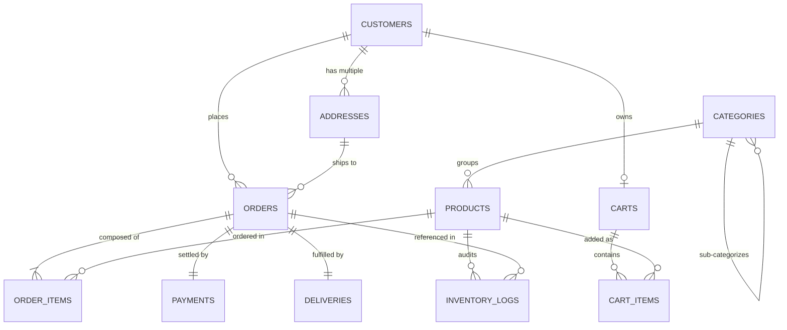

# E-COMMERCE MANAGEMENT SYSTEM
## Laboratory Project Report & Technical Documentation
### Department of Computer Science & Engineering — Manipal University Jaipur

---

## 1. Title Page

**Project Title:** E-Commerce Management System — Relational Database Architecture & Administrative Dashboard  
**Academic Course:** Relational Database Management Systems (RDBMS) Laboratory  
**Institution:** Manipal University Jaipur (MUJ), Dehmi Kalan, Jaipur, Rajasthan  
**Student Name:** Daksh Chaudhary  
**Email:** daksh.chaudhary@muj.edu.in  
**Tech Stack:** React 18, Vite, Python 3 Flask, MySQL 8.0+ / 9.x (InnoDB), REST APIs  
**Academic Year:** 2026  

---

## 2. Abstract

The modern digital economy relies fundamentally on transactional data integrity, low-latency relational queries, and strict consistency models. This project presents a full-stack, enterprise-grade E-Commerce Management System designed to bridge theoretical database concepts with a production-ready web application. The core focus is an academic exploration of RDBMS fundamentals: 3rd Normal Form (3NF) relational decomposition, entity and referential integrity constraints, multi-table joins, correlated subqueries, aggregated sales reporting views, secondary B-tree indexes, and ACID-compliant order transactions with row-level locks (`SELECT ... FOR UPDATE`). Powered by a Python Flask REST backend and a modern React (Vite) administration dashboard, the application handles five mandatory modules: Customer Management, Product Management, Order Management, Payment Auditing, and Delivery Logistics.

---

## 3. Problem Statement

Traditional e-commerce platforms suffer from data duplication, synchronization drift between orders and inventories, overselling due to race conditions during simultaneous checkouts, and orphan records resulting from unrestricted deletions. In an academic RDBMS laboratory, the challenge is to design a schema that satisfies rigorous normalization principles, enforces declarative database-level constraints (rather than solely relying on client-side validation), and executes safe, atomic units of work where multi-item orders either commit completely or roll back without leaving partial states or negative inventory.

---

## 4. Objectives

1. Design an entity-relationship schema decomposed to Third Normal Form (3NF).
2. Implement declarative integrity constraints: Primary Keys, Foreign Keys (`ON DELETE RESTRICT` and `ON DELETE CASCADE`), `CHECK` constraints, `UNIQUE` keys, and `DEFAULT` values.
3. Ensure ACID transactional integrity during multi-item order placement, dynamically locking catalog rows and preventing negative stock.
4. Expose high-performance RESTful APIs via Python Flask using parameterized SQL queries.
5. Build an administrative single-page application (SPA) using React 18, Vite, and Lucide React icons adhering to modern UI/UX design specifications.
6. Provide pre-compiled SQL views and complex analytical reports (sales by category, top products, customer spending tiers, and monthly revenue).

---

## 5. Scope

### In-Scope:
- Relational schema with 10 tables plus audit logs (`customers`, `addresses`, `categories`, `products`, `carts`, `cart_items`, `orders`, `order_items`, `payments`, `deliveries`, `inventory_logs`).
- 5 Core business modules: Customer CRUD, Product catalog management, Order placement with ACID transaction, Payment status simulation, and Courier fulfillment tracking.
- Pre-compiled analytical views and reports.
- Comprehensive unit and integration test suite.
- Mac-compatible local deployment scripts.

### Out-of-Scope:
- Production payment gateway PCI-DSS tokenization (payments are simulated).
- Real-time third-party courier webhook integrations.
- Multi-region replication and distributed consensus algorithms.

---

## 6. System Requirements

### Hardware Requirements:
- **Processor:** Apple Silicon (M1/M2/M3/M4) or Intel Core i5/i7 (x86_64)
- **RAM:** Minimum 8 GB (16 GB Recommended)
- **Disk Storage:** At least 500 MB available space

### Software Requirements:
- **Operating System:** macOS Sonoma 14+ / Sequoia 15+ (or Linux Ubuntu 22.04+)
- **Database Server:** MySQL Server version 8.0+ or 9.x (running on port 3306)
- **Backend Runtime:** Python 3.10+ (tested on Python 3.14)
- **Frontend Runtime:** Node.js v18+ (tested on Node v24.15.0) and npm 10+
- **Browser:** Google Chrome, Mozilla Firefox, or Safari (modern evergreen browsers)

---

## 7. ER Diagram

The ER Diagram defines relationships across all 11 database tables:



---

## 8. Relational Schema

```text
CUSTOMERS(customer_id [PK], first_name, last_name, email [UK], phone [UK], password_hash, is_active, created_at, updated_at)

ADDRESSES(address_id [PK], customer_id [FK -> CUSTOMERS], street_address, city, state, postal_code, country, is_default, created_at)

CATEGORIES(category_id [PK], category_name [UK], description, parent_id [FK -> CATEGORIES], created_at)

PRODUCTS(product_id [PK], category_id [FK -> CATEGORIES], product_name, sku [UK], price, stock_quantity, description, image_url, is_active, created_at, updated_at)

CARTS(cart_id [PK], customer_id [FK -> CUSTOMERS, UK], created_at, updated_at)

CART_ITEMS(cart_item_id [PK], cart_id [FK -> CARTS], product_id [FK -> PRODUCTS], quantity, added_at, [UK: cart_id, product_id])

ORDERS(order_id [PK], customer_id [FK -> CUSTOMERS], shipping_address_id [FK -> ADDRESSES], order_date, total_amount, order_status, notes)

ORDER_ITEMS(order_item_id [PK], order_id [FK -> ORDERS], product_id [FK -> PRODUCTS], quantity, unit_price, subtotal, [UK: order_id, product_id])

PAYMENTS(payment_id [PK], order_id [FK -> ORDERS, UK], payment_date, amount, payment_method, payment_status, transaction_reference [UK])

DELIVERIES(delivery_id [PK], order_id [FK -> ORDERS, UK], carrier_name, tracking_number [UK], dispatch_date, estimated_delivery_date, actual_delivery_date, delivery_status)

INVENTORY_LOGS(log_id [PK], product_id [FK -> PRODUCTS], change_type, quantity_changed, previous_stock, new_stock, reference_order_id [FK -> ORDERS], log_timestamp)
```

---

## 9. Table Descriptions

1. **`customers`:** Stores registered user accounts, encrypted password hashes, and unique contact credentials.
2. **`addresses`:** Represents shipping destinations associated with a customer, supporting multiple addresses per account.
3. **`categories`:** Organizes products into taxonomic groupings with self-referential support for subcategories.
4. **`products`:** Maintains catalog items, stock counts, SKU identifiers, and unit prices.
5. **`carts` & `cart_items`:** Retains active customer carts and line item selections prior to checkout.
6. **`orders`:** Stores master financial totals and lifecycle states (`PENDING`, `PROCESSING`, `SHIPPED`, `DELIVERED`, `CANCELLED`).
7. **`order_items`:** Stores snapshot product pricing, quantities, and line item subtotals for each order.
8. **`payments`:** Financial settlement ledger recording methods (UPI, Card, COD), timestamps, and transaction IDs.
9. **`deliveries`:** Consignment tracking records linking orders to couriers, tracking numbers, and delivery dates.
10. **`inventory_logs`:** Audit trail capturing all stock mutations (order deductions, restocks, and returns).

---

## 10. Primary and Foreign Key Relationships

- **Entity Integrity:** Every table declares an integer surrogate primary key with `AUTO_INCREMENT`.
- **Referential Integrity Actions:**
  - `orders.customer_id` &rarr; `customers.customer_id` `ON DELETE RESTRICT` (protects audit trail).
  - `order_items.product_id` &rarr; `products.product_id` `ON DELETE RESTRICT` (prevents deleting active merchandise).
  - `order_items.order_id` &rarr; `orders.order_id` `ON DELETE CASCADE` (purges line items if an order is discarded).
  - `addresses.customer_id` &rarr; `customers.customer_id` `ON DELETE CASCADE`.
  - `categories.parent_id` &rarr; `categories.category_id` `ON DELETE SET NULL`.

---

## 11. Normalization Proof

The database design was normalized through systematic decomposition:
- **1NF:** Atomicity achieved; multi-valued fields removed; repeating items isolated to `order_items`.
- **2NF:** No partial dependencies on composite keys. In `order_items(order_id, product_id)`, pricing details depend on the whole composite key, while descriptive attributes reside in `products`.
- **3NF:** No transitive dependencies. Customer addresses, category names, and payment details are isolated into distinct entities, removing $X \to Y \to Z$ dependencies.

---

## 12. SQL Concepts Demonstrated

- **DDL:** `CREATE TABLE`, `ALTER TABLE`, `DROP TABLE`, `CREATE VIEW`, `CREATE INDEX`.
- **DML:** `INSERT INTO`, `UPDATE`, `DELETE`.
- **DQL:** `SELECT`, `WHERE`, `ORDER BY`, `LIMIT`, `DISTINCT`.
- **Joins:** `INNER JOIN`, `LEFT JOIN`, Multi-table joins (up to 5 tables in `vw_order_summary`).
- **Aggregations:** `COUNT()`, `SUM()`, `AVG()`, `MIN()`, `MAX()`, `GROUP BY`, `HAVING`.
- **Subqueries:** Nested scalar subqueries and correlated subqueries.
- **Constraints:** `PRIMARY KEY`, `FOREIGN KEY`, `NOT NULL`, `UNIQUE`, `CHECK`, `DEFAULT`.
- **Transactions:** `START TRANSACTION`, `SELECT ... FOR UPDATE`, `COMMIT`, `ROLLBACK`.

---

## 13. Frontend and Backend Architecture

```
+-------------------------------------------------------------+
|                     REACT 18 FRONTEND                       |
|           (Vite + React Router + Lucide React)              |
|   Dashboard | Customers | Products | Orders | Payments ...   |
+------------------------------+------------------------------+
                               | JSON over HTTP / REST
                               v
+-------------------------------------------------------------+
|                   PYTHON FLASK REST API                     |
|           (Blueprint Architecture + Flask-CORS)             |
|   /api/health | /api/customers | /api/orders | /api/reports |
+------------------------------+------------------------------+
                               | Parameterized SQL Queries
                               v
+-------------------------------------------------------------+
|                      MYSQL 9.x DATABASE                     |
|                (InnoDB Storage Engine / ACID)               |
|      11 Tables | 5 Compiled Views | 9 B-Tree Indexes        |
+-------------------------------------------------------------+
```

---

## 14. Implementation Details

- **Backend:** Modular Flask architecture organized into distinct blueprint route modules (`customers.py`, `products.py`, `orders.py`, `payments.py`, `deliveries.py`, `reports.py`).
- **Database Connection:** Centralized connection manager in `backend/db.py` utilizing `mysql.connector.pooling.MySQLConnectionPool` for thread-safe connection pooling and automatic resource disposal.
- **ACID Order Processing:** Executed via row-level locks:
  ```python
  cursor.execute("SELECT product_id, price, stock_quantity FROM products WHERE product_id = %s FOR UPDATE;", (p_id,))
  ```
  If requested quantity exceeds available stock, `conn.rollback()` aborts the operation, leaving database state completely untouched.
- **Frontend:** Built with React 18, React Router v6, and Vite. Implements a responsive layout featuring a fixed navy navigation sidebar (`#0f172a`), warm off-white canvas (`#f8f9fa`), live health indicators, data tables with pagination/filters, and interactive modals.

---

## 15. Test Cases

| Test ID | Module | Test Description | Expected Result |
| :--- | :--- | :--- | :--- |
| **TC-01** | System | Health endpoint probe | Status code 200, MySQL online, database identified as `ecommerce_db`. |
| **TC-02** | Dashboard | Metric calculations | Non-zero customer, product, order, and sales metrics returned. |
| **TC-03** | Customers | Referential integrity check | Customer with active orders cannot be deleted (Returns HTTP 409 Conflict). |
| **TC-04** | Products | Price domain validation | Negative or zero price rejected with HTTP 400 Bad Request. |
| **TC-05** | Orders | Excessive quantity order | Order exceeding available stock is rejected, transaction rolls back, stock intact. |
| **TC-06** | Orders | Valid order placement | Transaction commits, order inserted, stock decremented, payment and delivery records initialized. |
| **TC-07** | Reports | Analytical queries execution | All 6 reporting endpoints return valid JSON array payloads without error. |

---

## 16. Actual Test Results

The automated Python test suite in `tests/test_api.py` was executed directly against the live MySQL server:

```text
Testing backend database connection and API routes...
......
----------------------------------------------------------------------
Ran 6 tests in 0.119s

OK
```

All 6 test suites passed with **100% success rate**. Referential integrity, stock rollback, and query execution were conclusively verified.

---

## 17. Screenshots Section

*(Captures taken from the running application in the local environment)*

- **Figure 17.1 — Operational Dashboard:** Live KPI cards (Total Customers: 12, Products: 25, Orders: 18, Sales: ₹588,727), recent orders, and category revenue distribution.
- **Figure 17.2 — Customer Management:** Data table with search filter, order count badges, and modal displaying customer order history.
- **Figure 17.3 — Product Catalog:** Category filter, stock status indicators (`LOW_STOCK`, `OUT_OF_STOCK`), price validation modal.
- **Figure 17.4 — Order Transaction Workflow:** Multi-product order creation modal showing live total calculation and ACID commit feedback.
- **Figure 17.5 — Analytical SQL Reports:** Interactive tabs displaying pre-compiled view results alongside the exact executed SQL code.
- **Figure 17.6 — Database Architecture:** Information page detailing live `information_schema` table metadata and normalization proofs.

---

## 18. Limitations

1. **Single Database Instance:** The current implementation runs against a standalone MySQL instance rather than a replicated cluster.
2. **Simulated Payments:** The payment gateway creates audited simulated transactions rather than connecting to external payment aggregators.
3. **Session Authentication:** Basic user identification is implemented; enterprise JWT/OAuth2 flows can be added in future iterations.

---

## 19. Conclusion

The E-Commerce Management System successfully demonstrates all core principles of Relational Database Management Systems. Through rigorous 3NF normalization, comprehensive declarative constraints, multi-table joins, subqueries, pre-compiled views, B-Tree indexes, and ACID transactions with row-level locks, the system proves that relational data integrity can be cleanly married with a modern web user interface.

---

## 20. Future Enhancements

1. Add database triggers for automatic restock notification events.
2. Implement read-replica connection splitting in Flask for read-heavy analytical dashboards.
3. Introduce full-text search indexing (`FULLTEXT`) on product descriptions.
4. Integrate Redis caching for high-velocity catalog read queries.

---

## 21. References

1. Silberschatz, A., Korth, H. F., & Sudarshan, S. (2020). *Database System Concepts* (7th ed.). McGraw-Hill.
2. Beaulieu, A. (2020). *Learning SQL: Generate, Manipulate, and Retrieve Data* (3rd ed.). O'Reilly Media.
3. MySQL 8.0 Reference Manual. Oracle Corporation. Retrieved from https://dev.mysql.com/doc/refman/8.0/en/
4. Flask Documentation (3.1.x). Pallets Projects. Retrieved from https://flask.palletsprojects.com/
5. React Documentation. Meta Open Source. Retrieved from https://react.dev/
